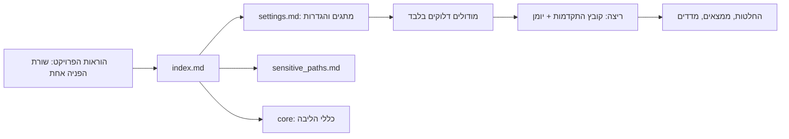

# מושגים

מסמך: concepts | גרסה: 0.1 | סטטוס: טיוטה | עודכן: 2026-10-23 | מתאר פרוטוקול: PROTOMOTAI_V1 (טיוטה)

> המסמך מסביר את הרעיונות. את הכללים המדויקים תמצאו ב-[proto_draft/core/protocol_core.md](../proto_draft/core/protocol_core.md), וברשימות המלאות ב-[reference](reference/modules.md).

## מבט כללי

## 1. אישור ממוספר לפני פעולה
לפני כל פעולה או מקבץ פעולות Claude מציג רשימה ממוספרת וממתין. אתם עונים "אשר 1,3 / דחה 2 / שנה 4: ...". מספר שלא הוזכר הוא לא מאושר, ואישור חל רק על מה שהוצג.

הפעולות מדורגות לפי סיכון:
| רמה | מה כולל | איזה אישור |
|---|---|---|
| R0 | קריאה בהיקף שאושר | אישור אחד לשלב |
| R1 | כתיבה בתיקיית הכתיבה | אישור לרשימה |
| R2 | מחיקה, התקנה, רשת והורדה, sudo, push, הפעלה מחדש של שירות, כתיבה מחוץ להיקף, העברת קבצים החוצה (גם העלאה ל-Project) | אישור נפרד לכל פעולה |

**כלי שלא רשום ברישום הכלים נחשב R2.**

## 2. היקף: איפה מותר לכתוב ולקרוא
קובץ היקף מגדיר שלוש קבוצות: תיקיית כתיבה אחת, תיקיות לקריאה בלבד, וכל השאר אסור (גם לקריאה). פרויקטים אחרים על אותו מחשב הם בקריאה בלבד, ורק אם הוגדרו.

## 3. סודות ונתיבים רגישים
קובץ `sensitive_paths.md` נותן לכל נתיב מדיניות אחת:
- **deny**: לא פותחים. נפתח רק ב"בקשה מפורשת" שלכם, בהודעה אחת: נתיב מדויק של קובץ אחד, מטרה, ו"אשר קריאה". תקף לקריאה אחת, והתוכן עדיין עובר מיסוך.
- **mask**: נקרא רק דרך פקודת מיסוך (לא `cat` ישיר), כך שהערך הגולמי לא נכנס לצ'אט: (מפתחות כמו password, token, api_key מוחלפים ב-`****`).
- **allow**: קובץ ששמו נראה רגיש אבל אין בו סוד.

אם סוד הופיע בפלט כלי: מדווחים מיד בלי לחזור עליו, לא כותבים אותו לקובץ או ל-git, ומציעים להחליף אותו.

## 4. מודולים ומתגים
הליבה תמיד פעילה. כל השאר מודולים שמדליקים ומכבים בטבלה אחת ב-`settings.md`. מודול בן פעיל רק אם האב שלו דלוק. כלי אחד מעדכן את שורת הכותרת בכל קובץ מודול לפי הטבלה.

| מודול | תפקיד | ברירת מחדל |
|---|---|---|
| server_link | עבודה מול שרת | דלוק |
| git_ops | נקודות חזרה ו-commit | דלוק |
| secure_dev | התמחות בפיתוח מאובטח | דלוק |
| agents | הפעלת סוכנים, נעילת ריצה, טוקנים, החלטות אוטומטיות | כבוי |
| project_lifecycle | שמונה שלבי פרויקט ואשפים לפי סוג משתמש | כבוי |
| migration | מעבר מפרויקט קיים | כבוי |

הרשימה המלאה: [reference/modules.md](reference/modules.md).

## 5. ריצה, יומן וחזרה
כל ריצה, גם קצרה, מקבלת קובץ התקדמות (`runs/run_<תאריך>_<נושא>.md`) ויומן (`.log`, אנגלית, חותמת זמן UTC). רושמים **מיד**, לא בסוף: פעולות, ממצאים, החלטות ולקחים. בצ'אט חדש קוראים את הקובץ האחרון ואת סוף היומן, ומשווים ל-git. נקודת כניסה: "הבא בתור" בראש `todo.md`.

### שאלת נושא בתחילת כל צ'אט
Claude לא רואה את שם הצ'אט ולא זוכר צ'אטים קודמים. לכן בכל צ'אט חדש, אחרי קריאת נקודת הכניסה, הוא שואל "על איזה נושא נעבוד?" (סיעור מוחות, החלטה, שאלה פתוחה, תרחיש, ביצוע, סקירה, המשך, או שיחה חופשית) ומציע לתעד בקובץ המתאים לפי טבלת הניתוב ב-`topics.md`. כל כתיבה באישור ממוספר, ושורה אחת לכל נושא נרשמת ב-`runs/sessions.md`. המתג `session_start_question` ב-`settings.md`.

## 6. החלטות, שאלות ותרחישים
מזהים קבועים שלא ממוחזרים: `d-<n>` החלטה, `q-<n>` שאלה פתוחה, `sc-<n>` תרחיש קבלה, `tool-<n>` כלי. סיעור מוחות לא מחייב. רק החלטה מאושרת מחייבת, ולכל החלטה נרשמות החלופות שנדחו.

## 7. תבניות
כל קובץ נוצר מתבנית רשומה. רישום התבניות הוא מקום אחד, ובו לכל תבנית מזהה, נתיב תוצר ושדות חובה. כלי קטן בודק שהשדות מולאו.

## 8. כלים
כל כלי רשום ב-`tools.md` עם מה הוא עושה, **מתי מפעילים** אותו, סיכון, ואם הוא נאכף או רק הוראה. הוראות השימוש המלאות נשארות בכותרת הכלי עצמו.

## 9. סיווג אכיפה
כל כלל מסווג לאחד משלושה:
- **enforced**: כלי חוסם.
- **warn-only**: כלי מזהיר ולא חוסם.
- **instruction-only**: הוראה בלבד, כלל חשוב שהוא הוראה בלבד מחייב הליך מכני משלים.

## 10. מדדים ותחזיות
כל ריצה מקבלת שורה אוטומטית ב-`runs/metrics.md`: משך, זמן פעיל, ספירת פעולות, ממצאים והחלטות. טוקנים וניצול סשן נרשמים **רק כפי שדווחו** ולא מנוחשים. תחזית זמן מכוילת מותרת רק אחרי מספר ריצות מינימלי, ותמיד מוצגת עם גודל המדגם, החציון והטווח.

## 11. מסירה ותוצרים
שלושה מצבי עבודה: `server` (הצ'אט קורא מהשרת), `upload` (דפים יציבים מועלים לזיכרון ה-AI, כצילום ולא כמקור אמת) ו-`hybrid` (מעלים רק אינדקס קצר; הפרטים נקראים מהשרת כשיש חיבור). דוגמה ל-upload: מעלים ל-Project ב-claude.ai את `index.md`, `settings.md` ו-`core/protocol_core.md`; הצ'אט עובד לפי הצילום, ושינוי בפרוטוקול מחייב העלאה מחדש באישור. "זיכרון ה-AI" כאן הוא מסמכי ה-Project ב-claude.ai. פירוט ב-[delivery_modes](../proto_draft/core/delivery_modes.md). תוצרים נשמרים בתיקיית `deliverables/` בפורמט שתבחרו (ברירת מחדל או רשימה ממוספרת).

## 12. מחזור חיי פרויקט (אופציונלי)
מודול `project_lifecycle` מוביל משתמש בלי רקע בניהול פרויקטים מרעיון ועד סגירה: שמונה שלבים עם שער בסוף כל אחד (רק הבעלים מעביר שער), ואשפים לפי סוג משתמש.

## 13. פרוטוקול מרוחק, כלים ופרוטוקולי אבטחה
**שלוש שכבות.** הפרוטוקול (לקריאה בלבד, מקומי או מ-GitHub ציבורי מקובע ל-commit מלא), הגדרות הפרויקט (`project_settings.md`, רק דריסות) וקבצי הפרויקט (ריצות, יומנים, החלטות). ההגדרות והקבצים נשארים מקומיים. סדר העדיפות: הוראות הפרויקט, אחריהן `project_settings.md`, אחריו ברירות המחדל של הפרוטוקול. כללי ליבה (אישור ממוספרת, סודות, היקף, רמות R0-R2) לא ניתנים לדריסה.

**קטלוגי כלים.** `tools_build/` מתאר כלים שבונים בעצמכם: למה צריך, מה הוא עושה, מה נדרש ליישום (בלי קוד). `tools_install/` מתאר כלים שמתקינים או מייבאים, ולכל אחד גרסה מקובעת (`pin`) ופקודה שמוודאת את הגרסה (`verify_command`). ההתקנה מקומית, באישור ממוספר, עם אזהרה שהאחריות לבדוק את המקור היא שלכם. מה הותקן ובאיזו גרסה נרשם ב-`project_tools.md`.

**פרוטוקולי אבטחה.** התיקייה `security/` מכילה פרוטוקול לכל נושא (כרגע: הורדות והתקנות): צעדים, סיכונים ורשימת בדיקה. תיאור כלי מקשר לפרוטוקול שחל עליו.

## 14. תרחישים ועקיבות
רעיון חדש מתחיל בסיעור מוחות. בכל נושא רושמים **תרחישים מועמדים**: מי עושה מה, ומה התוצאה הצפויה הניתנת לבדיקה. כשנושא מוכרע (`d-<n>`), כל דרישת "חייב" שנגזרת ממנו מקבלת תרחיש `sc-<n>` ושורה בטבלת עקיבות (דרישה, עדיפות, תרחישים). בסוף הפיתוח, **ריצת קבלה** מריצה כל תרחיש חוסם, רושמת הוכחה ואת ה-commit שנבדק, וכישלון נרשם כממצא. רק הבעלים מכריז שהשער עבר. הכלי `check_traceability.py` מזהיר על דרישת חייב בלי תרחיש, על תרחיש "בוצע" בלי הוכחה, ועל הוכחה ישנה מול הקוד הנוכחי.

## 15. פרופילים מקצועיים (תחומי התמחות)
פרופיל מכוון את Claude להסתכל על ההקשר מזווית מסוימת (תפקיד, תקן או טכנולוגיה). הוא מודול התמחות עם מניפסט ומתג דלוק או כבוי, ואפשר להדליק אותו לפרויקט אחד בלבד ב-`project_settings.md`. פרופיל רשאי להחמיר כללים ולא להקל, ואינו הסמכה רשמית. הרישום ב-`proto_draft/profiles.md`, ולתרומה: [contributing_profiles.md](contributing_profiles.md). רשימת כל המזהים ופירושם: [reference/ids.md](reference/ids.md).

## מילון מונחים
| מונח | משמעות |
|---|---|
| ריצה | עבודה אחת מתועדת: קובץ התקדמות ויומן |
| בדיקת התחלה קרה | סוכן ללא הקשר קורא רק את נקודת הכניסה ועונה על שאלות; כשל מצביע על חוסר או סתירה במסמכים |
| R0 / R1 / R2 | דרגות סיכון של פעולה (קריאה / כתיבה בהיקף / מסוכנת) |
| שאלת נושא | השאלה בתחילת כל צ'אט "על איזה נושא נעבוד?", שקובעת לאיזה קובץ מתעדים |
| pin | גרסה מקובעת של כלי או פרוטוקול (digest, hash או commit מלא), ללא `latest` |
| verify_command | פקודת קריאה שמדפיסה את הגרסה המותקנת, להשוואה ל-pin לפני כל שימוש |
| נקודת חזרה | תג git לפני שינוי, כדי שאפשר לחזור |
| נעילת ריצה ו-takeover | קובץ שמונע משני צ'אטים לכתוב יחד; takeover הוא לקיחת נעילה תקועה, רק באישור |
| מיסוך | החלפת ערך רגיש ב-`****` לפני קריאה |
| mount לקריאה בלבד | חיבור תיקייה כך שאי אפשר לכתוב אליה |
| E0-E2 | רמות חשיפת רשת בריצה עם החלטות אוטומטיות (אין / מתוכננת / אחר = עוצרים) |
| החלטה אוטומטית (`ad-<n>`) | החלטה שהצ'אט מקבל לבד במודול agents, בכפוף לחוקי עצירה |
| תבנית (`T-...`) | קובץ מוכן עם שדות חובה; הרישום קובע את מזהה התבנית ואת נתיב התוצר |

