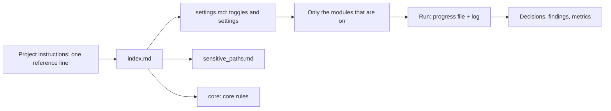

# Concepts

[English](concepts.md) | [עברית](../he/concepts.md)

Document: concepts | Version: 0.1 | Status: draft | Updated: 2026-10-25 | Protocol version: PROTOMOTAI_V1 (draft)

> This document explains the ideas. The exact rules are in [proto_draft/core/protocol_core.md](../../proto_draft/core/protocol_core.md) (Hebrew), and the full lists are in the [reference](../reference/modules.md) (Hebrew, generated).

## Overview

## 1. Numbered approval before an action
Before every action or group of actions Claude presents a numbered list and waits. You answer "approve 1,3 / reject 2 / change 4: ...". A number that was not mentioned is not approved, and an approval applies only to what was presented.

Actions are graded by risk:
| Level | What it includes | Which approval |
|---|---|---|
| R0 | Reading within the approved scope | One approval for the stage |
| R1 | Writing in the writing folder | Approval for the list |
| R2 | Deletion, installation, network and downloads, sudo, push, restarting a service, writing outside the scope, sending files out (including uploading to a Project) | A separate approval for each action |

**A tool that is not in the tool registry is treated as R2.**

## 2. Scope: where it may write and read
A scope file defines three groups: one writing folder, read-only folders, and everything else is forbidden (even to read). Other projects on the same computer are read-only, and only if they were defined.

## 3. Secrets and sensitive paths
The file `sensitive_paths.md` gives each path one policy:
- **deny**: not opened. Opened only on your "explicit request", in one message: the exact path of one file, a purpose, and "approve reading". Valid for one read, and the content still goes through masking.
- **mask**: read only through a masking command (not a direct `cat`), so the raw value does not enter the chat: (keys such as password, token, api_key are replaced with `****`).
- **allow**: a file whose name looks sensitive but contains no secret.

If a secret appeared in tool output: it is reported immediately without repeating it, it is not written to a file or to git, and replacing it is suggested.

## 4. Modules and toggles
The core is always active. Everything else is a module that is turned on and off in one table in `settings.md`. A child module is active only if its parent is on. One tool updates the header line in each module file according to the table.

| Module | Role | Default |
|---|---|---|
| server_link | Working against a server | on |
| git_ops | Restore points and commits | on |
| secure_dev | Secure development specialization | off (turned on in `project_settings.md` with the owner's approval) |
| agents | Running agents, run lock, tokens, automatic decisions | off |
| project_lifecycle | Eight project stages and wizards by user type | off |
| migration | Moving from an existing project | off |

The full list: [reference/modules.md](../reference/modules.md).

## 5. Run, log and resuming
Every run, even a short one, gets a progress file (`runs/run_<date>_<subject>.md`) and a log (`.log`, English, UTC timestamp). Records are made **immediately**, not at the end: actions, findings, decisions and lessons. In a new chat the latest file and the end of the log are read, and compared against git. Entry point: "Next up" at the top of `todo.md`.

### The topic question at the start of every chat
Claude does not see the chat's name and does not remember previous chats. So in every new chat, after reading the entry point, it asks "what topic are we working on?" (brainstorming, a decision, an open question, a scenario, execution, a review, a continuation, or a free conversation) and suggests documenting in the matching file according to the routing table in `topics.md`. Every write is under numbered approval, and one line per topic is recorded in `runs/sessions.md`. The toggle is `session_start_question` in `settings.md`.

## 6. Decisions, questions and scenarios
Fixed identifiers that are never reused: `d-<n>` a decision, `q-<n>` an open question, `sc-<n>` an acceptance scenario, `tool-<n>` a tool. Brainstorming is not binding. Only an approved decision is binding, and for every decision the rejected alternatives are recorded.

## 7. Templates
Every file is created from a registered template. The template registry is a single place, and in it each template has an identifier, an output path and required fields. A small tool checks that the fields were filled in.

## 8. Tools
Every tool is registered in `tools.md` with what it does, **when to run** it, its risk, and whether it is enforced or only an instruction. The full usage instructions stay in the tool's own header.

## 9. Enforcement classification
Every rule is classified into one of three:
- **enforced**: a tool blocks.
- **warn-only**: a tool warns and does not block.
- **instruction-only**: an instruction only; an important rule that is instruction-only requires a complementary mechanical procedure.

## 10. Metrics and forecasts
Every run gets an automatic line in `runs/metrics.md`: duration, active time, action count, findings and decisions. Tokens and session usage are recorded **only as reported** and are not guessed. Claude cannot see the usage by itself, so before launching agents it reminds the owner to report it. A calibrated time forecast is allowed only after a minimum number of runs, and is always shown with the sample size, the median and the range.

## 11. Delivery and outputs
Three working modes: `server` (the chat reads from the server), `upload` (stable pages are uploaded to the AI's memory, as a snapshot and not a source of truth) and `hybrid` (only a short index is uploaded; the details are read from the server when there is a connection). An example of upload: you upload `index.md`, `settings.md` and `core/protocol_core.md` to a Project in claude.ai; the chat works from the snapshot, and a change in the protocol requires uploading again with approval. "The AI's memory" here means the Project documents in claude.ai. Details in [delivery_modes](../../proto_draft/core/delivery_modes.md). Outputs are saved in the `deliverables/` folder in the format you choose (the default or a numbered list).

## 12. Project life cycle (optional)
The `project_lifecycle` module guides a user with no project-management background from idea to closure: eight stages with a gate at the end of each (only the owner passes a gate), and wizards by user type.

## 13. Remote protocol, tools and security protocols
**Three layers.** The protocol (read-only, local or from a public GitHub repository pinned to a full commit), the project settings (`project_settings.md`, overrides only) and the project files (runs, logs, decisions). The settings and files stay local. Order of precedence: core rules (numbered approval, secrets, scope, risk levels R0-R2, which cannot be overridden), then the project instructions, then `project_settings.md`, then the protocol's defaults.

**Tool catalogs.** `tools_build/` describes tools that you build yourself: why it is needed, what it does, what is needed to implement it (without code). `tools_install/` describes tools that are installed or imported, and each has a pinned version (`pin`) and a command that verifies the version (`verify_command`). Installation is local, under numbered approval, with a warning that the responsibility to check the source is yours. What was installed and in which version is recorded in `project_tools.md`.

**Security protocols.** The `security/` folder contains a protocol for each subject (currently: downloads and installations): steps, risks and a checklist. A tool description links to the protocol that applies to it.

## 14. Scenarios and traceability
A new idea starts in brainstorming. In each topic you record **candidate scenarios**: who does what, and what the expected, testable result is. When a topic is decided (`d-<n>`), every "must" requirement derived from it gets a scenario `sc-<n>` and a row in the traceability table (requirement, priority, scenarios). At the end of development, an **acceptance run** runs every blocking scenario, records proof and the commit that was tested, and a failure is recorded as a finding. Only the owner declares that the gate was passed. The tool `check_traceability.py` warns about a must requirement with no scenario, a "done" scenario with no proof, and proof that is old compared with the current code.

## 15. Professional profiles (specializations)
A profile directs Claude to look at the context from a particular angle (a role, a standard or a technology). It is a specialization module with a manifest and an on or off toggle, and it can be turned on for one project only in `project_settings.md`. A profile may tighten rules and not relax them, and it is not an official certification. The registry is in `proto_draft/profiles.md`, and for contributing: [contributing_profiles.md](contributing_profiles.md). A list of all identifiers and their meaning: [reference/ids.md](../reference/ids.md).

## Glossary
| Term | Meaning |
|---|---|
| Run | One documented piece of work: a progress file and a log |
| Cold-start test | An agent with no context reads only the entry point and answers questions; a failure points to a gap or contradiction in the documents |
| R0 / R1 / R2 | Action risk levels (reading / writing within scope / dangerous) |
| Topic question | The question at the start of every chat, "what topic are we working on?", which determines which file to document in |
| pin | A fixed version of a tool or protocol (a digest, hash or full commit), never `latest` |
| verify_command | A read-only command that prints the installed version, to compare with the pin before each use |
| Restore point | A git tag before a change, so that it is possible to go back |
| Run lock and takeover | A file that prevents two chats from writing together; takeover is taking a stuck lock, only with approval |
| Masking | Replacing a sensitive value with `****` before reading |
| Read-only mount | Connecting a folder so that it cannot be written to |
| E0-E2 | Network exposure levels in a run with automatic decisions (none / planned / other = stop) |
| Automatic decision (`ad-<n>`) | A decision the chat makes by itself in the agents module, subject to stop rules |
| Template (`T-...`) | A ready file with required fields; the registry determines the template identifier and the output path |
